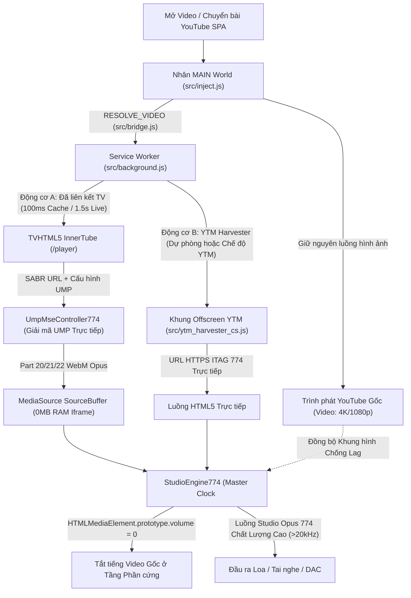

<div align="center">
  
  <h1>YTSpoofingStream</h1>
  <p><b>Kích Hoạt 100% Luồng Âm Thanh Studio Opus 774 Chuẩn Phòng Thu Trên Trình Duyệt YouTube</b></p>

  <p>
    <a href="https://github.com/alithw/YTSpoofingStream/releases"></a>
    
    
    
    <a href=".github/CONTRIBUTING.md"></a>
    <a href=".github/CODE_OF_CONDUCT.md"></a>
    <a href=".github/SECURITY.md"></a>
    <a href="https://github.com/sponsors/alithw"></a>
    <a href="https://ko-fi.com/alithw"></a>
  </p>
</div>

*Đọc bằng ngôn ngữ khác: [English](README.md).*

Nếu tiện ích giúp trải nghiệm nghe nhạc của bạn trên YouTube tốt hơn, hãy để lại 1 sao (⭐ **Star**) trên [GitHub](https://github.com/alithw/YTSpoofingStream) để ủng hộ dự án nhé!

**Lưu ý trước khi sử dụng:**
- **Cần có tài khoản YouTube Premium**: Máy chủ của YouTube chỉ phân phối luồng âm thanh Opus chất lượng cao (`ITAG 774`, ~256k–301kbps, dải tần >20kHz) và AAC (`ITAG 141`, ~256kbps) cho các phiên đăng nhập có gói YouTube Premium. Tài khoản miễn phí sẽ không nhận được các luồng này từ hệ thống của Google.
- **Đăng nhập TVHTML5 (Khuyên dùng)**: Để giải mã trực tiếp luồng `ITAG 774` qua `MediaSource` (không tốn RAM tạo iframe ngầm, hoạt động trên cả các bản cover, live session và video UGC không có trên YouTube Music), hãy mở popup của tiện ích, nhấn nút đăng nhập **TVHTML5** và liên kết đúng tài khoản Google có gói Premium.
- **Phiên bản mới nhất ([v0.2.7](https://github.com/alithw/YTSpoofingStream/releases/tag/v0.2.7))**: Triệt tiêu khoảng lặng âm thanh 3–5 giây đầu khi chuyển bài, gỡ móc hoàn toàn khi tắt extension, và xóa bỏ cảnh báo lỗi dynamic URL của Chrome MV3. [Xem chi tiết cập nhật v0.2.7 bên dưới ↓](#recent-updates)

---

## 📑 Mục lục
- [✨ Có gì mới trong phiên bản v0.2.7](#recent-updates)
- [🌟 Tại sao bạn cần YTSpoofingStream?](#-tại-sao-bạn-cần-ytspoofingstream)
- [🧠 Kiến trúc Hệ thống (v0.2.7)](#-kiến-trúc-hệ-thống-v026)
  - [1. Cấu trúc Thư mục & Mã nguồn](#1-cấu-trúc-thư-mục--mã-nguồn)
  - [2. Nền tảng SABR / UMP của YouTube & Vì sao phương pháp cũ thất bại](#2-nền-tảng-sabr--ump-của-youtube--vì-sao-phương-pháp-cũ-thất-bại)
  - [3. Quy trình Thu hoạch & Giải mã Luồng Kép 774 (`UmpMseController774` + `YTM_HARVESTER`)](#3-quy-trình-thu-hoạch--giải-mã-luồng-kép-774-umpmsecontroller774--ytm_harvester)
  - [4. Tắt tiếng Tầng Descriptor Phần cứng & Cơ chế Chống Tự Tắt Tiếng (Anti-Mute Guard)](#4-tắt-tiếng-tầng-descriptor-phần-cứng--cơ-chế-chống-tự-tắt-tiếng-anti-mute-guard)
  - [5. Đồng bộ Chuẩn Master Clock 1.0x & Chống Nhảy Nhạc Khi Trình Duyệt Lag](#5-đồng-bộ-chuẩn-master-clock-10x--chống-nhảy-nhạc-khi-trình-duyệt-lag)
- [🎛️ 4 Chế độ Hoạt động](#️-4-chế-độ-hoạt-động)
- [🚀 Hướng dẫn Cài đặt](#-hướng-dẫn-cài-đặt)
- [🌐 Hỗ trợ Đa Ngôn Ngữ & Hướng dẫn Đóng góp Bản dịch](#-hỗ-trợ-đa-ngôn-ngữ--hướng-dẫn-đóng-góp-bản-dịch)
- [⚙️ Cấu hình & Điều khiển](#️-cấu-hình--điều-khiển)
- [🐞 Xử lý Sự cố & Câu hỏi Thường gặp](#-xử-lý-sự-cố--câu-hỏi-thường-gặp)
- [💖 Ủng Hộ & Tài Trợ Dự Án](#-ủng-hộ--tài-trợ-dự-án)
- [⭐ Star History](#star-history)
- [🤝 Đóng góp & Cộng đồng (Contributing)](#-đóng-góp--cộng-đồng-contributing)
- [⚠️ Tuyên bố Từ chối Trách nhiệm (Disclaimer)](#️-tuyên-bố-từ-chối-trách-nhiệm-disclaimer)
- [📄 Giấy phép (License)](#-giấy-phép-license)

---

<a id="recent-updates"></a>
## ✨ Có gì mới trong phiên bản v0.2.7

Bản cập nhật **v0.2.7** bổ sung tính năng cân bằng âm lượng chuẩn phòng thu, hoàn thiện độ mượt khi chuyển đổi miniplayer và ngăn ngừa rò rỉ âm thanh khi điều hướng:

- **Tính năng Cân bằng Âm lượng (Volume Balance)**:
  - Khớp chuẩn xác với tiêu chuẩn **-14 LUFS** của trình phát YouTube bằng cách tự động tính toán hệ số bù âm lượng ($10^{-\text{loudnessDb}/20}$) từ trường dữ liệu `audioConfig.loudnessDb`.
  - Triệt tiêu hoàn toàn hiện tượng "mất cân bằng âm thanh" (âm lượng nhảy bất ngờ quá to hoặc quá nhỏ) khi chuyển giữa các bài hát có luồng 774 và các bài không có 774 (fallback về luồng gốc `251`), hoặc giữa các bài hát có độ lớn mastering khác nhau.
- **Khắc phục vọt âm lượng (Volume Spike) khi bật Miniplayer**:
  - Bổ sung cửa sổ chờ điều hướng SPA trong `isPlayerActiveOnPage()` khi trình phát đang phát nhạc, ngăn chặn việc ngắt sớm luồng 774 và làm lộ âm thanh gốc của trình phát trong quá trình chuyển đổi giao diện.
- **Ngăn ngừa rò rỉ âm thanh khi điều hướng thanh bên (Sidebar Navigation)**:
  - Khắc phục triệt để lỗi rò rỉ âm thanh khi phát video đơn lẻ lúc chuyển qua lại giữa các tab bằng các nút điều hướng trên thanh bên (sidebar) của YouTube, đảm bảo ngắt luồng 774 kịp thời và chuẩn xác khi rời khỏi trang phát.

---

## 🌟 Tại sao bạn cần YTSpoofingStream?

Trên hệ sinh thái YouTube hiện nay, chất lượng âm thanh bị phân tầng nghiêm ngặt:
- **YouTube Web thông thường (`www.youtube.com`)**: Giới hạn âm thanh ở mức bitrate thấp (**ITAG 251** Opus ~145–160kbps bị cắt phẳng dải tần cao ở 15–16kHz, hoặc **ITAG 140** AAC ~128kbps), **kể cả đối với tài khoản trả phí YouTube Premium**.
- **YouTube Music Bản Web (`music.youtube.com`)**: Dù là dịch vụ âm nhạc chuyên dụng, **phiên bản Web của YouTube Music chỉ hỗ trợ tối đa luồng AAC 141 (~256kbps)** và **hoàn toàn không phân phối luồng Opus 774 trên trình duyệt máy tính**.
- **Nơi duy nhất YouTube phân phối luồng Opus 774**: Luồng âm thanh chuẩn phòng thu cao cấp nhất (**ITAG 774** Opus ~256k–301kbps với phổ âm đầy đủ vượt 20.000 Hz) chỉ được cấp độc quyền cho ứng dụng YouTube Music di động (Android/iOS) và thiết bị Smart TV Living Room (`TVHTML5`).

### ❓ Làm thế nào YTSpoofingStream mở khóa luồng ITAG 774 trên trình duyệt máy tính?
1. **Giải mã trực tiếp luồng TVHTML5 UMP/SABR**: Truy vấn trực tiếp máy chủ InnerTube `TVHTML5` bằng token OAuth2 TV Premium của bạn, đàm phán luồng `ITAG 774` qua giao thức nhị phân SABR/UMP của Google Video, và bóc tách trực tiếp các gói Opus vào bộ đệm `MediaSource` ngay trên trang.
2. **Thu hoạch Phiên Xác thực YouTube Music (YTM Harvester)**: Khi người dùng chưa đăng nhập TVHTML5 hoặc với các bản thu độc quyền trên YTM, khung offscreen cô lập sẽ truy vấn endpoint nội bộ của YouTube Music kèm bộ quy tắc DNR giả lập thiết bị để trích xuất URL HTTPS **Opus 774** trực tiếp.
3. **Động cơ Đồng bộ Luồng Kép (`StudioEngine774`)**: Phát luồng âm thanh Opus 774 chuẩn phòng thu qua kênh âm thanh độc lập trong khi ngắt tiếng của video gốc ở tầng descriptor phần cứng trình duyệt, giữ nguyên chất lượng hình ảnh 4K/1080p và mọi nút điều khiển trên giao diện YouTube.

---

## 🧠 Kiến trúc Hệ thống (v0.2.7)

### 1. Cấu trúc Thư mục & Mã nguồn
YTSpoofingStream được xây dựng bằng **100% JavaScript thuần (Vanilla ES6+)**—không dùng bundler, không thư viện ngoài hay mã thực thi từ xa—đảm bảo hiệu năng tối đa, minh bạch và dễ kiểm toán:

```text
YTSpoofingStream/
├── manifest.json               # Cấu hình Manifest V3, quyền hạn & khai báo content scripts
├── src/
│   ├── background.js           # MV3 Service Worker: Bộ phân giải InnerTube TV/YTM, OAuth2 & DNR
│   ├── inject.js               # Nhân MAIN world: StudioEngine774, UmpMseController774, HUD & đồng bộ
│   ├── bridge.js               # Cầu nối ISOLATED world: Chuyển tiếp thông điệp (MAIN <-> SW)
│   ├── ytm_harvester_cs.js     # Script MAIN world bên trong khung offscreen YTM Harvester
│   ├── harvester.html / .js    # Khung tài liệu Offscreen phục vụ YTM Harvester
│   └── popup.html / .js        # Giao diện cấu hình Popup, bảng đo trạng thái & bộ điều khiển đa ngôn ngữ
├── assets/
│   └── logo.svg, icon*.png     # Bộ nhận diện thương hiệu & biểu tượng thanh công cụ
├── locales/
│   └── en, vi, ja, ru, zh-cn, zh-tw  # Từ điển đa ngôn ngữ tích hợp & file mẫu dịch thuật (template.json)
└── .github/
    └── CONTRIBUTING.md, ...    # Hướng dẫn đóng góp, chính sách bảo mật & mẫu báo lỗi
```

### 2. Nền tảng SABR / UMP của YouTube & Vì sao phương pháp cũ thất bại
Trình phát YouTube máy tính hiện đại đã chuyển hoàn toàn sang giao thức truyền phát nhị phân **SABR (Server-side Adaptive Bitrate) / UMP (Unified Media Protocol)** của Google:
- Phản hồi `/youtubei/v1/player` trên trình duyệt không còn trả về đường link trực tiếp trong `adaptiveFormats`. Thay vào đó, dữ liệu video và audio được đóng gói nhị phân và đẩy qua `serverAbrStreamingUrl`, bị khóa cứng ở chuẩn `ITAG 251` (~160kbps Opus) trên web.
- **Vì sao cách ghi đè format cũ thất bại**:
  1. Xóa bỏ `serverAbrStreamingUrl` sẽ kích hoạt lỗi trình phát nghiêm trọng mã `s:80` (`HTML5_NO_AVAILABLE_FORMATS_FALLBACK`).
  2. Tiêm trực tiếp URL của TV/Android vào trình phát mặc định sẽ gây lỗi bảo mật CORS và lệch chữ ký token mã `s:49` (`poToken` / `cplatform`).

### 3. Quy trình Thu hoạch & Giải mã Luồng Kép 774 (`UmpMseController774` + `YTM_HARVESTER`)
Để đạt độ ổn định tuyệt đối không bao giờ gây lỗi trình phát mà vẫn phát đúng luồng `ITAG 774` nguyên bản, **YTSpoofingStream v0.2.7** tách biệt hoàn toàn luồng hiển thị hình ảnh và luồng thu nhận âm thanh phòng thu thông qua 2 động cơ chuyên biệt:



1. **Động cơ A — Bộ Giải mã Trực tiếp TV UMP-to-MSE (`UmpMseController774`)**:
   - Sử dụng token OAuth2 `TVHTML5` trong [`src/background.js`](src/background.js) để lấy cấu hình `/player` của Smart TV (`100ms` nếu đã có cache làm nóng trước, tối đa `1500ms` cho truy vấn mạng trực tiếp).
   - Đóng gói payload nhị phân Protobuf `VideoPlaybackAbrRequest` ghim cố định vào `ITAG 774` (`rn`, `rbuf`, `ClientAbrState`, `FormatId`) và nhận luồng phản hồi từ Google Video CDN.
   - Phân tích cấu trúc khung nhị phân UMP theo thời gian thực ngay trong [`src/inject.js`](src/inject.js) (`Part 20 MEDIA_HEADER`, `Part 21 MEDIA`, `Part 22 MEDIA_END`, `Part 35 NEXT_REQUEST_POLICY`, `Part 43 SABR_REDIRECT`, `Part 58 STREAM_PROTECTION_STATUS`) và nạp trực tiếp các phân đoạn WebM/Opus vào `MediaSource` `SourceBuffer` kèm cơ chế tự động giải phóng bộ nhớ đệm (sliding-window eviction).
2. **Động cơ B — Bộ Thu hoạch Offscreen YouTube Music (`YTM_HARVESTER`)**:
   - Hoạt động trong tài liệu offscreen nhẹ ([`src/harvester.html`](src/harvester.html) + [`src/ytm_harvester_cs.js`](src/ytm_harvester_cs.js)) kết hợp quy tắc mạng Declarative Net Request (DNR) để trích xuất URL HTTPS `ITAG 774` trực tiếp từ phiên YouTube Music Premium.
   - Đóng vai trò là động cơ chính trong chế độ `YTM_HARVESTER`, đồng thời là động cơ dự phòng tự động tức thì cho chế độ `HYBRID_HQ`.

### 4. Tắt tiếng Tầng Descriptor Phần cứng & Cơ chế Chống Tự Tắt Tiếng (Anti-Mute Guard)
Nếu gán trực tiếp `video.muted = true` hoặc `video.volume = 0` qua thuộc tính DOM thông thường, trình duyệt sẽ bắn sự kiện `volumechange`, khiến trình phát YouTube hiểu nhầm là người dùng vừa tắt tiếng, hiển thị biểu tượng loa gạch chéo và lưu trạng thái `"muted": true` vào `localStorage['yt-player-volume']`.

**YTSpoofingStream v0.2.7** giải quyết triệt để thông qua cơ chế bảo vệ 2 lớp trong [`src/inject.js`](src/inject.js):
1. **Định tuyến Descriptor Nguyên mẫu**: Gọi trực tiếp setter gốc `HTMLMediaElement.prototype.volume` (`descVolume.set.call(video, 0)`) để hạ âm lượng phần cứng của thẻ `<video>` về `0`, trong khi ghi đè getter để giao diện YouTube luôn đọc đúng mức âm lượng mà người dùng thiết lập.
2. **Lá chắn Chống Tự Tắt Tiếng Khi Chuyển Bài**: Chặn toàn bộ các sự kiện `volumechange` nội bộ phát sinh trong quá trình đóng/mở âm lượng phần cứng (`_suppressNextVolumeEvent`) và chủ động khôi phục trạng thái unmute khi chuyển từ bài hát `★ 774` sang các video `251` không có 774 (`fallbackTo251()`), đảm bảo giao diện không bao giờ bị kẹt nút Mute.

### 5. Đồng bộ Chuẩn Master Clock 1.0x & Chống Nhảy Nhạc Khi Trình Duyệt Lag (Phát Luồng Chất Lượng Cao)
`StudioEngine774` lấy luồng âm thanh `<audio>` làm đồng hồ chuẩn (Master Clock) xuyên suốt quá trình phát:
- **Giữ nguyên bản 100% tốc độ 1.0x**: `audio.playbackRate` khóa cứng theo `video.playbackRate` (`1.0x`), tuyệt đối không dùng thuật toán co giãn tốc độ `0.99x`/`1.01x` gây méo tiếng hay biến dạng cao độ.
- **Khóa Chống Tự Tua Ngược Khi Chuyển Bài SPA**: Bỏ qua các lệnh tự seek lùi nội bộ của YouTube (`timeJump < -0.25s`) trong `1500ms` đầu tiên khi mới chuyển bài hoặc khi `video.currentTime < 1.5s`, chấm dứt hiện tượng nhạc đang phát giây đầu bị khựng và nhảy lại từ đầu.
- **Căn chỉnh Khung hình Chống Lag**: Khi chuyển tab hoặc khi trình duyệt/GPU bị lag làm rớt khung hình video, luồng âm thanh 774 vẫn tiếp tục phát mượt mà không bị ngắt quãng. Chỉ khi bộ giải mã video đã nạp đủ bộ đệm (`video.readyState >= 3`), đồng hồ hình ảnh mới nhẹ nhàng nhảy tiến lên khớp với `audio.currentTime` (ngưỡng lệch `> 0.35s` kèm chu kỳ nghỉ `2.5s`).

**Làm rõ về khái niệm "Bit-perfect" và luồng âm thanh nén chất lượng cao:**  
Hệ thống phân phối âm thanh của YouTube sử dụng định dạng nén suy hao (Opus và AAC), vì vậy không có tiện ích trình duyệt nào là "bit-perfect" theo nghĩa phần cứng audiophile (truyền tín hiệu PCM/FLAC không nén trực tiếp tới DAC qua WASAPI Exclusive hoặc ASIO). Vai trò của YTSpoofingStream là mở khóa và nhận về luồng âm thanh có chất lượng cao nhất hiện có trên máy chủ YouTube (**ITAG 774** Opus ở mức ~256k–301kbps với dải tần đầy đủ trên 20kHz, thay vì luồng mặc định ITAG 251 ~160kbps bị cắt ở ~15.5kHz trên bản web), đồng thời giữ tốc độ phát chuẩn 1.0x không qua co giãn cao độ.

---

## 🎛️ 4 Chế độ Hoạt động

| Chế độ | Tên hiển thị | Động cơ thu nhận chính | Cơ chế Dự phòng / Fallback | Phù hợp nhất |
|---|---|---|---|---|
| **`HYBRID_HQ`** *(Khuyên dùng)* | **Chế độ: Hỗn hợp Hybrid (774 Opus ★)** | **Direct TV UMP-to-MSE 774** (khi đã liên kết TV) + **YTM Harvester** | Tự động chuyển sang YTM Harvester nếu TV không có 774; về luồng gốc `251` nếu cả hai đều không có 774 | Nghe nhạc & xem YouTube hàng ngày, danh sách phát, MV & nhạc cover |
| **`YTM_HARVESTER`** | **Chỉ YTM Harvester (774 Opus ★)** | Luồng HTTPS 774 trực tiếp từ YouTube Music Offscreen Harvester | Tự động về luồng gốc `251` nếu bài hát không có trên YTM | Các bài hát chính thức trên YouTube Music (không cần đăng nhập TV) |
| **`TV_HEADLESS`** | **Chỉ Smart TV UMP (774 Opus ★)** | Giải mã trực tiếp luồng `TVHTML5` UMP/SABR 774 qua `MediaSource` (0MB RAM iframe) | Tự động về luồng gốc `251` nếu chưa đăng nhập TV hoặc video không có 774 | Phát nhạc độ trễ bằng 0, tốn ít RAM nhất, bản cover, live session & video UGC |
| **`TV_RELAY`** | **Smart TV Relay (SABR Cũ 774 ★)** | Ghi đè gói tin nhị phân Protobuf SABR trực tiếp trên luồng player gốc (`251 → 774`) | Tự động về luồng gốc `251` nếu TV không có luồng 774 | Ghi đè luồng truyền thống trực tiếp trên player gốc, ổn định cao |

**Một vài lưu ý về chế độ phát và âm lượng:**
- **Khi nào nên dùng `TV_RELAY`**: Dựa trên phản hồi của người dùng, chế độ ghi đè luồng SABR trực tiếp trên trình phát gốc đã được đưa trở lại dưới tên **Smart TV Relay (`TV_RELAY`)**. Nếu máy của bạn gặp bất kỳ sự cố tương thích nào với cơ chế đồng bộ hai luồng, bạn có thể chuyển sang `TV_RELAY` để trình phát mặc định của YouTube tự xử lý toàn bộ.
- **Chênh lệch âm lượng & Tính năng Cân bằng Âm lượng (Volume Balance)**: Các bản nhạc lấy từ YouTube Music (`YTM_HARVESTER`) thường nghe to hơn khoảng **+3dB đến +6dB** so với video YouTube thông thường, do bản thu trên YouTube Music được chuẩn hóa âm lượng theo tiêu chuẩn riêng của nền tảng nhạc số. Với tính năng **Volume Balance**, tiện ích tự động điều chỉnh độ lớn âm thanh theo chuẩn **-14 LUFS** của YouTube, loại bỏ hiện tượng "mất cân bằng âm thanh" khi chuyển giữa bài có luồng 774 và bài không có luồng 774.
- **Độ trễ khi tải 2 luồng (Dual-Stream Delay)**: Đối với mode YTM và Smart TV UMP sẽ delay khoảng 0,15–1,5s phụ thuộc vào tình trạng mạng của bạn để tải 2 luồng.

---

## 🚀 Hướng dẫn Cài đặt
 
### Trình duyệt Chromium (Google Chrome, Brave, Edge, Cốc Cốc, Opera)
1. Tải hoặc clone mã nguồn về máy tính:
   - **Dành cho người dùng phổ thông (không cần dùng Git)**:  
     Nhấn vào nút **Code** màu xanh lá ở phía trên trang GitHub này rồi chọn **Download ZIP** (hoặc truy cập mục [Releases](https://github.com/alithw/YTSpoofingStream/releases), kéo xuống dưới cùng của bản phát hành mới nhất tại mục *Assets* và tải file `Source code (zip)`). Sau đó, giải nén file ZIP vào một thư mục trên máy tính.
   - **Dành cho nhà phát triển (sử dụng Git)**:
     ```bash
     git clone https://github.com/alithw/YTSpoofingStream.git
     ```
2. Mở trình duyệt và truy cập `chrome://extensions/`.
3. Bật **Chế độ dành cho nhà phát triển (Developer mode)** ở góc trên bên phải.
4. Nhấn nút **Tải tiện ích đã giải nén (Load unpacked)** và chọn thư mục gốc `YTSpoofingStream` (thư mục chứa file `manifest.json`).
5. Mở YouTube, đảm bảo đã đăng nhập tài khoản có Premium, và thưởng thức âm thanh chuẩn phòng thu với huy hiệu `★ 774` trên thanh điều khiển!

### Trình duyệt Mozilla Firefox / Firefox ESR
Phiên bản dành cho Mozilla Firefox đã ngừng hỗ trợ từ [commit 63ff08d](https://github.com/alithw/YTSpoofingStream/commit/63ff08dc622278be8c58eb7db5513c1cb170b100) do các giới hạn kỹ thuật của nhân Gecko (cơ chế CORS, chặn iframe nền và hạn chế luồng phát trên Manifest V3). Vui lòng sử dụng các trình duyệt nhân Chromium (Google Chrome, Microsoft Edge, Brave, Cốc Cốc, Opera).

---

## 🌐 Hỗ trợ Đa Ngôn Ngữ & Hướng dẫn Đóng góp Bản dịch

YTSpoofingStream hỗ trợ sẵn 6 ngôn ngữ ngay khi cài đặt (**English**, **Tiếng Việt**, **日本語**, **Русский**, **简体中文**, và **繁體中文**) cùng tính năng tự động nhận diện ngôn ngữ trình duyệt.

### Bạn muốn bổ sung ngôn ngữ của mình?
Chúng tôi rất hoan nghênh các bản dịch từ cộng đồng! Bạn có thể đóng góp ngôn ngữ mới chỉ với 3 bước đơn giản:

1. **Sao chép file mẫu (Template)**:  
   Nhân bản file [`locales/template.json`](locales/template.json) và đổi tên thành mã ngôn ngữ chuẩn ISO 639-1 của bạn (ví dụ: `ko.json` cho tiếng Hàn, `fr.json` cho tiếng Pháp, `de.json` cho tiếng Đức, `es.json` cho tiếng Tây Ban Nha...) đặt trong thư mục `locales/`.
2. **Dịch các chuỗi văn bản**:  
   - Điền thông tin vào trường `_meta` (tên ngôn ngữ, tên bản địa, mã ngôn ngữ, tác giả/GitHub handle).
   - Dịch chính xác từng giá trị tương ứng sang ngôn ngữ của bạn, giữ nguyên các biến placeholder (`{version}`, `{method}`, `{label}`, `{error}`, `{url}`) và các ký hiệu đặc biệt (`★`, `•`, `↻`, `⟳`).
3. **Khai báo & Tạo Pull Request**:  
   - Thêm thẻ `<option value="mã_ngôn_ngữ">Tên ngôn ngữ</option>` vào menu dropdown `#langSelect` trong [`src/popup.html`](src/popup.html).
   - Gửi Pull Request (PR) lên repository!

---

## ⚙️ Cấu hình & Điều khiển

- **Bật tiện ích (Enable Extension)**: Công tắc tổng tắt toàn bộ can thiệp mạng và đưa trình duyệt về chế độ phát YouTube nguyên bản.
- **Chế độ hoạt động (Operation Mode)**: Lựa chọn giữa `HYBRID_HQ` (Khuyên dùng), `YTM_HARVESTER`, `TV_HEADLESS`, hoặc `TV_RELAY` (SABR Cũ).
- **Cân bằng Âm lượng (Volume Balance)**: Tự động điều chỉnh độ lớn âm thanh theo tiêu chuẩn -14 LUFS của YouTube, loại bỏ hiện tượng mất cân bằng âm thanh giữa các bài có luồng 774 và các bài không có luồng 774.
- **Chế độ Chỉ Âm thanh (Audio-Only Mode)**: Tạm dừng kết xuất hình ảnh video (có thể bật nhanh bằng biểu tượng tai nghe nằm ngay cạnh huy hiệu `★ 774` trên thanh điều khiển video) giúp tiết kiệm tối đa RAM & CPU/GPU khi chỉ nghe nhạc.
- **Tự động tải lại trang khi đổi thiết lập**: Tự động tải lại tab YouTube khi bạn đổi chế độ hoạt động.
- **Ghi đè Thống kê chi tiết (Stats for Nerds Override)**: Hiển thị thông số codec Opus 774 và bitrate thời gian thực ngay trong bảng *Stats for Nerds* của YouTube.
- **Đăng nhập TVHTML5 (TVHTML5 Login)**: Cổng xác thực OAuth2 giúp liên kết tài khoản YouTube Premium của bạn với động cơ `TVHTML5`.

---

## 🐞 Xử lý Sự cố & Câu hỏi Thường gặp

**Hỏi: Vì sao có video chỉ hiện `251` thay vì `★ 774`?**  
Đáp: Một số video (như vlog trò chuyện, tin tức hoặc video đời cũ) chỉ được máy chủ YouTube mã hóa tối đa ở chuẩn ITAG 251. Tiện ích kiểm tra nghiêm ngặt tính xác thực của luồng âm thanh: nếu video không có luồng 774 thực sự, tiện ích sẽ tự động chuyển về phát luồng gốc `251` để đảm bảo âm thanh liền mạch không lỗi.

**Hỏi: Extension có ảnh hưởng đến trang web YouTube Music (`music.youtube.com`) không?**  
Đáp: Các content script của tiện ích đã được loại trừ khỏi giao diện `music.youtube.com`, **tuy nhiên**, nếu bạn mở trực tiếp trang `music.youtube.com` để nghe nhạc, chúng tôi khuyên bạn nên gạt công tắc **`Bật tiện ích: OFF`** trong popup để các quy tắc mạng Declarative Net Request (DNR) chạy ngầm của YTM Harvester không làm ảnh hưởng tới hàng đợi phát của `music.youtube.com`. Lưu ý rằng bản thân trang web `music.youtube.com` trên máy tính chỉ hỗ trợ tối đa luồng `AAC 141` (~256kbps)—để thưởng thức chất âm **Opus 774** chuẩn phòng thu, hãy mở nhạc trực tiếp trên **YouTube thường (`www.youtube.com`)** cùng YTSpoofingStream!

---

## 💖 Ủng Hộ & Tài Trợ Dự Án

Nếu **YTSpoofingStream** mang lại trải nghiệm nghe nhạc tuyệt vời hơn cho bạn trên YouTube, bạn có thể ủng hộ và đồng hành cùng tác giả để tiếp thêm động lực nghiên cứu và duy trì tiện ích:

<p align="center">
  <a href="https://github.com/sponsors/alithw" target="_blank">
    
  </a>
  &nbsp;&nbsp;
  <a href="https://ko-fi.com/alithw" target="_blank">
    
  </a>
</p>

Bạn có thể tài trợ trực tiếp qua **[GitHub Sponsors (github.com/sponsors/alithw)](https://github.com/sponsors/alithw)** hoặc mời một ly cà phê qua **[Ko-fi (ko-fi.com/alithw)](https://ko-fi.com/alithw)**. Mọi sự ủng hộ và đồng hành của bạn đều là nguồn động lực rất lớn! ☕✨

---

## Star History

<a href="https://www.star-history.com/?repos=alithw%2Fytspoofingstream&type=date&legend=top-left">
 <picture>
   <source media="(prefers-color-scheme: dark)" srcset="https://api.star-history.com/chart?repos=alithw/ytspoofingstream&type=date&theme=dark&legend=top-left" />
   <source media="(prefers-color-scheme: light)" srcset="https://api.star-history.com/chart?repos=alithw/ytspoofingstream&type=date&legend=top-left" />
   
 </picture>
</a>

---

## 🤝 Đóng góp & Cộng đồng (Contributing)

Dự án luôn hoan nghênh mọi sự đóng góp từ cộng đồng! Dù bạn muốn báo lỗi, đóng góp ý tưởng khai thác luồng hay tối ưu hóa mã nguồn, vui lòng tham khảo các tài liệu chỉ dẫn:

- 📘 **[Cẩm nang Đóng góp (CONTRIBUTING.md)](.github/CONTRIBUTING.md)**: Hướng dẫn cài đặt môi trường lập trình, cấu trúc thư mục dự án, tiêu chuẩn code vanilla ES6+ và checklist kiểm tra trước khi gửi PR.
- 📜 **[Quy tắc Ứng xử (CODE_OF_CONDUCT.md)](.github/CODE_OF_CONDUCT.md)**: Tiêu chuẩn ứng xử văn minh, tôn trọng và hỗ trợ lẫn nhau trong cộng đồng theo chuẩn Contributor Covenant 2.1.
- 🔒 **[Chính sách Bảo mật (SECURITY.md)](.github/SECURITY.md)**: Quy trình báo cáo lỗ hổng bảo mật có trách nhiệm.
- 🐛 **[Báo cáo Sự cố (Bug Report)](https://github.com/alithw/YTSpoofingStream/issues/new?template=bug_report.yml)**: Mẫu báo cáo lỗi chi tiết kèm URL video và log console.
- 💡 **[Đề xuất Tính năng (Feature Request)](https://github.com/alithw/YTSpoofingStream/issues/new?template=feature_request.yml)**: Nơi chia sẻ ý tưởng cải tiến thuật toán và chất lượng âm thanh.

---

## ⚠️ Tuyên bố Từ chối Trách nhiệm (Disclaimer)

- **Dự án Độc lập**: YTSpoofingStream là một dự án mã nguồn mở độc lập và **không** có bất kỳ liên kết, ủy quyền, chứng thực hay liên hệ chính thức nào với YouTube, Google LLC hay Alphabet Inc. Trang web chính thức của YouTube tại [https://www.youtube.com](https://www.youtube.com). "YouTube" và "YouTube Music" là các nhãn hiệu đã được đăng ký của Google LLC.
- **Không Phá khóa DRM**: Tiện ích mở rộng này **hoàn toàn không** bẻ khóa DRM Widevine, không can thiệp nội dung bản quyền được mã hóa và không hỗ trợ tải lậu video/nhạc. Tiện ích chỉ hoạt động trong phạm vi phiên duyệt web hợp lệ của người dùng nhằm định tuyến các luồng phát đã được cấp phép.
- **Mục đích Nghiên cứu & Cá nhân**: Phần mềm được phát triển phục vụ mục đích nghiên cứu học thuật và trải nghiệm cá nhân. Người dùng tự chịu trách nhiệm khi sử dụng tiện ích theo Điều khoản Dịch vụ của YouTube. Phần mềm được cung cấp dưới dạng "nguyên trạng" (as-is) và không đi kèm bất kỳ cam kết hay bảo đảm nào.

---

## 📄 Giấy phép (License)

Dự án được phân phối dưới **Giấy phép Apache 2.0 (Apache License 2.0)**. Xem chi tiết tại file [`LICENSE`](LICENSE).
