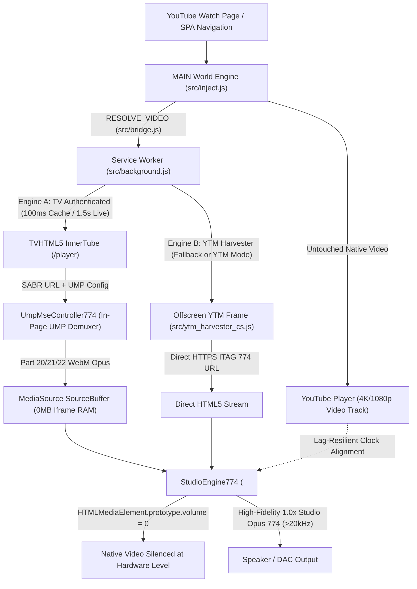

<div align="center">
  
  <h1>YTSpoofingStream</h1>
  <p><b>Force 100% Genuine Studio Opus 774 Audio on YouTube via Dual-Stream Synchronization Engine</b></p>

  <p>
    <a href="https://github.com/alithw/YTSpoofingStream/releases"></a>
    
    
    
    <a href=".github/CONTRIBUTING.md"></a>
    <a href=".github/CODE_OF_CONDUCT.md"></a>
    <a href=".github/SECURITY.md"></a>
    <a href="https://github.com/sponsors/alithw"></a>
    <a href="https://ko-fi.com/alithw"></a>
  </p>
</div>

*Read this in other languages: [Tiếng Việt](README-vi.md).*

If this extension makes your music sound better on YouTube, consider leaving a ⭐ **Star** on [GitHub](https://github.com/alithw/YTSpoofingStream).

**Before You Start:**
- **YouTube Premium Required**: YouTube only serves unthrottled `ITAG 774` Opus (~256k–301kbps, >20kHz) and `ITAG 141` AAC (~256kbps) to authenticated YouTube Premium accounts. Free accounts do not receive these streams from Google's servers.
- **TVHTML5 Login (Recommended)**: To stream `ITAG 774` directly via `MediaSource` (zero iframe memory overhead, works on covers and UGC videos not listed on YouTube Music), open the extension popup, click **Login to TVHTML5**, and link the Google account that holds your Premium subscription.
- **Latest Release ([v0.2.6](https://github.com/alithw/YTSpoofingStream/releases/tag/v0.2.6))**: Adds Volume Balance matching YouTube's -14 LUFS standard to prevent loudness imbalance, eliminates volume spikes when toggling miniplayer, and prevents audio leakage during sidebar navigation. [Jump to what's new in v0.2.6 ↓](#recent-updates)

---

## 📑 Table of Contents
- [✨ What's New in v0.2.6](#recent-updates)
- [🌟 Why YTSpoofingStream?](#-why-ytspoofingstream)
- [🧠 System Architecture (v0.2.6)](#-system-architecture-v026)
  - [1. Codebase & Directory Structure](#1-codebase--directory-structure)
  - [2. YouTube's SABR / UMP Infrastructure & Why Legacy Spoofing Fails](#2-youtubes-sabr--ump-infrastructure--why-legacy-spoofing-fails)
  - [3. Dual-Engine 774 Acquisition Pipeline (`UmpMseController774` + `YTM_HARVESTER`)](#3-dual-engine-774-acquisition-pipeline-umpmsecontroller774--ytm_harvester)
  - [4. Hardware-Level Descriptor Volume Silencing & Anti-Mute Guard](#4-hardware-level-descriptor-volume-silencing--anti-mute-guard)
  - [5. Native 1.0x Master Clock & Lag-Resilient Synchronization (High-Fidelity Audio Delivery)](#5-native-10x-master-clock--lag-resilient-synchronization-high-fidelity-audio-delivery)
- [🎛️ Operation Modes](#️-operation-modes)
- [📊 Full-Track FFT Spectrum Benchmark Results](#-full-track-fft-spectrum-benchmark-results)
- [🚀 Installation](#-installation)
- [🌐 Localization & Adding Your Language](#-localization--adding-your-language)
- [⚙️ Configuration & Controls](#️-configuration--controls)
- [🐞 Troubleshooting & FAQ](#-troubleshooting--faq)
- [💖 Support / Sponsor the Project](#-support--sponsor-the-project)
- [⭐ Star History](#star-history)
- [🤝 Contributing & Community](#-contributing--community)
- [⚠️ Disclaimer](#️-disclaimer)
- [📄 License](#-license)

---

<a id="recent-updates"></a>
## ✨ What's New in v0.2.6

**v0.2.6** introduces studio loudness normalization, smooths miniplayer transitions, and resolves audio leakage during navigation:

- **Volume Balance (-14 LUFS Loudness Normalization)**:
  - Dynamically aligns auxiliary Studio 774 audio output with YouTube's standard **-14 LUFS** loudness target by calculating real-time normalization gain ($10^{-\text{loudnessDb}/20}$) from `audioConfig.loudnessDb`.
  - Eliminates jarring volume jumps ("loudness imbalance") when transitioning between Studio 774 tracks and standard non-774 (`ITAG 251`) fallback videos or across songs mastered at different loudness levels.
- **Miniplayer Transition Volume Guard**:
  - Eliminates transient volume spikes when toggling between the full player and miniplayer by introducing an SPA navigation grace window in `isPlayerActiveOnPage()` while playback is active, preventing premature 774 stoppage and native audio unmuting.
- **Audio Leak Prevention on Navigation**:
  - Fixes audio leakage when playing a single video and navigating across pages or tabs via YouTube sidebar navigation buttons, ensuring auxiliary 774 audio cleanly halts when leaving the watch view.

---

## 🌟 Why YTSpoofingStream?

Across YouTube's ecosystem today, audio quality is strictly tiered:
- **Standard YouTube Web (`www.youtube.com`)**: Artificially limits audio playback to low-bitrate streams (**ITAG 251** Opus at ~145–160kbps with a steep brickwall frequency cutoff at 15–16kHz, or **ITAG 140** AAC at ~128kbps), **even for paying YouTube Premium subscribers**.
- **YouTube Music Web Client (`music.youtube.com`)**: Despite being a dedicated music service, **the web browser version of YouTube Music only serves up to AAC 141 (~256kbps)** and **does not serve ITAG 774 Opus to desktop web browsers**.
- **The Only Places YouTube Serves Opus 774**: The highest-fidelity unclipped studio sound (**ITAG 774** Opus at ~256k–301kbps with full frequency spectrum exceeding 20,000 Hz) is locked away, served exclusively to YouTube Music mobile apps (Android/iOS) and Smart TV Living Room devices (`TVHTML5`).

### ❓ How Does YTSpoofingStream Unlock Authentic ITAG 774 on Desktop Web?
1. **Direct TVHTML5 UMP/SABR Demuxing**: Queries YouTube's `TVHTML5` InnerTube endpoint using your linked TV Premium OAuth token, negotiates an unthrottled `ITAG 774` stream via Google Video's SABR/UMP protocol, and demuxes the binary Opus chunks directly into an in-page `MediaSource` buffer.
2. **Authenticated YTM Session Harvesting**: When TVHTML5 is not linked or a track is YTM-exclusive, an isolated offscreen subframe queries YouTube Music's internal endpoints under emulated high-tier client rules to extract the direct HTTPS **Opus 774** URL.
3. **Dual-Stream Synchronization Engine (`StudioEngine774`)**: Plays the pristine Opus 774 studio stream through a dedicated audio pipeline while silencing the native video's audio at the browser hardware descriptor level, keeping 4K/1080p video and all YouTube UI controls 100% intact.

---

## 🧠 System Architecture (v0.2.6)

### 1. Codebase & Directory Structure
YTSpoofingStream is built with **100% pure vanilla JavaScript (ES6+)**—no bundlers, external libraries, or remote dependencies—for maximum speed, security, and auditability:

```text
YTSpoofingStream/
├── manifest.json               # Manifest V3 configuration, permissions & content script bindings
├── src/
│   ├── background.js           # MV3 Service Worker: InnerTube TV/YTM resolver, OAuth2 & DNR rules
│   ├── inject.js               # MAIN world core: StudioEngine774, UmpMseController774, HUD & sync
│   ├── bridge.js               # ISOLATED world bridge: Bidirectional message relay (MAIN <-> SW)
│   ├── ytm_harvester_cs.js     # MAIN world harvester script inside offscreen YTM subframe
│   ├── harvester.html / .js    # Offscreen document container for YTM Harvester
│   └── popup.html / .js        # Extension popup UI, live status telemetry & i18n controller
├── assets/
│   └── logo.svg, icon*.png     # Extension branding & vector/raster toolbar icons
├── locales/
│   └── en, vi, ja, ru, zh-cn, zh-tw  # Built-in i18n dictionaries & translation template
└── .github/
    └── CONTRIBUTING.md, ...    # Community guidelines, security policy & issue templates
```

### 2. YouTube's SABR / UMP Infrastructure & Why Legacy Spoofing Fails
Modern YouTube desktop web streaming uses Google's proprietary **SABR (Server-side Adaptive Bitrate) / UMP (Unified Media Protocol)**:
- The `/youtubei/v1/player` response on desktop web no longer exposes standalone media URLs in `adaptiveFormats`. Instead, encrypted/multiplexed binary chunks are pushed over `serverAbrStreamingUrl`, strictly capped at `ITAG 251` (~160kbps Opus) for desktop browsers.
- **Why legacy format-replacement extensions fail**:
  1. Deleting `serverAbrStreamingUrl` triggers fatal player error `s:80` (`HTML5_NO_AVAILABLE_FORMATS_FALLBACK`).
  2. Injecting mobile/TV URLs directly into YouTube's native player triggers CORS and token-binding errors `s:49` (`poToken` / client platform mismatch).

### 3. Dual-Engine 774 Acquisition Pipeline (`UmpMseController774` + `YTM_HARVESTER`)
To guarantee 100% crash-free playback while delivering unthrottled studio `ITAG 774`, **YTSpoofingStream v0.2.6** completely decouples video rendering from studio audio acquisition using two specialized engines:



1. **Engine A — Direct TV UMP-to-MSE Demuxer (`UmpMseController774`)**:
   - Uses your authenticated `TVHTML5` OAuth2 token in [`src/background.js`](src/background.js) to fetch the TV `/player` response (`100ms` fast path on pre-warmed cache, `1500ms` cap on live query).
   - Constructs custom Protobuf `VideoPlaybackAbrRequest` payloads pinned specifically to `ITAG 774` (`rn`, `rbuf`, `ClientAbrState`, and `FormatId` descriptors) and streams the response from Google Video CDN.
   - Parses Google's binary UMP framing in real time inside [`src/inject.js`](src/inject.js) (`Part 20 MEDIA_HEADER`, `Part 21 MEDIA`, `Part 22 MEDIA_END`, `Part 35 NEXT_REQUEST_POLICY`, `Part 43 SABR_REDIRECT`, `Part 58 STREAM_PROTECTION_STATUS`) and appends the raw WebM/Opus initialization and media segments directly into a browser `MediaSource` `SourceBuffer` with automatic sliding-window buffer eviction.
2. **Engine B — Authenticated YTM Offscreen Harvester (`YTM_HARVESTER`)**:
   - Operates in a lightweight offscreen document ([`src/harvester.html`](src/harvester.html) + [`src/ytm_harvester_cs.js`](src/ytm_harvester_cs.js)) backed by scoped Declarative Net Request (DNR) rules to extract direct HTTPS `ITAG 774` URLs from YouTube Music Premium sessions.
   - Serves as both the primary engine in `YTM_HARVESTER` mode and the automatic zero-interruption failover engine in `HYBRID_HQ` mode.

### 4. Hardware-Level Descriptor Volume Silencing & Anti-Mute Guard
Setting `video.muted = true` or `video.volume = 0` via standard DOM properties causes the browser to dispatch `volumechange` events, which tricks YouTube's player into showing a muted speaker icon and persisting `"muted": true` into `localStorage['yt-player-volume']`.

**YTSpoofingStream v0.2.6** solves this with a two-layer hardware descriptor shield in [`src/inject.js`](src/inject.js):
1. **Prototype Descriptor Routing**: Calls the native `HTMLMediaElement.prototype.volume` setter (`descVolume.set.call(video, 0)`) directly on the `<video>` element while intercepting property getters so YouTube's player UI always sees the user's chosen volume and mute state.
2. **Transition Anti-Mute Guard**: Suppresses synthetic `volumechange` events triggered during hardware silencing/restoration (`_suppressNextVolumeEvent`) and proactively unmutes stale player states when transitioning from a `★ 774` song to a standard `251` video (`fallbackTo251()`), ensuring the player never gets stuck muted across playlist changes.

### 5. Native 1.0x Master Clock & Lag-Resilient Synchronization (High-Fidelity Audio Delivery)
`StudioEngine774` treats the studio `<audio>` stream as the continuous master clock:
- **Zero Pitch/Resampling Artifacts**: `audio.playbackRate` is strictly locked to `video.playbackRate` (`1.0x` native playback)—never micro-adjusted with `0.99x`/`1.01x` pitch warbling.
- **SPA Transition Seek Lock**: Ignores YouTube's internal SPA reload seeks (`timeJump < -0.25s`) during the first `1500ms` of a track switch or when `video.currentTime < 1.5s`, preventing songs from restarting a second after playback begins.
- **Lag-Resilient Forward Alignment**: When backgrounding tabs or heavy CPU/GPU load causes video frames to drop, the audio continues playing smoothly without interruption. Once the video decoder has sufficient buffered data (`video.readyState >= 3`), the video clock gently aligns forward to match `audio.currentTime` (`drift > 0.35s` threshold with a `2.5s` cooldown).

**A Note on "Bit-Perfect" vs. High-Fidelity Compressed Audio:**  
YouTube's audio infrastructure distributes lossy compressed formats (Opus and AAC), so no browser extension can be "bit-perfect" in the strict hardware audiophile sense (uncompressed PCM/FLAC sent directly to a DAC via WASAPI Exclusive or ASIO). What YTSpoofingStream does is fetch the highest-bitrate audio tier available on YouTube's servers (**ITAG 774** Opus at ~256k–301kbps with full frequency response above 20kHz, rather than desktop web's default 160kbps ITAG 251 cut off at ~15.5kHz) and play it at a locked 1.0x clock without pitch resampling.

---

## 🎛️ Operation Modes

| Mode | Name | Primary Acquisition Engine | Failover / Fallback Behavior | Best For |
|---|---|---|---|---|
| **`HYBRID_HQ`** *(Recommended)* | **Hybrid Mix (774 Opus ★)** | **Direct TV UMP-to-MSE 774** (when TV linked) + **YTM Harvester** | Auto-failovers from TV UMP to YTM Harvester if TV lacks 774; falls back to native `251` if neither has 774 | Everyday YouTube listening, playlists, MVs & covers |
| **`YTM_HARVESTER`** | **YTM Harvester Only (774 Opus ★)** | Direct HTTPS 774 from YouTube Music Offscreen Harvester | Falls back cleanly to native `251` if no YTM 774 stream exists | Official music tracks & albums without TV login |
| **`TV_HEADLESS`** | **Smart TV UMP Only (774 Opus ★)** | Direct `TVHTML5` UMP/SABR 774 Demuxer via `MediaSource` (0MB iframe RAM) | Falls back cleanly to native `251` if no TV login or no TV 774 stream | Zero-overhead playback, covers, live sessions & UGC videos |
| **`TV_RELAY`** | **Smart TV Relay (Legacy SABR 774 ★)** | Standalone Native Player SABR Body Rewrite (`251 → 774`) | Falls back cleanly to native `251` if TV has no 774 stream | Traditional in-place stream override without auxiliary audio elements |

**Notes on Modes & Loudness:**
- **When to use `TV_RELAY`**: Based on community feedback, we brought back the classic in-place SABR stream override as **Smart TV Relay (`TV_RELAY`)**. If you ever run into quirks with the dual-stream engine on your setup, you can switch to `TV_RELAY` so YouTube's native player handles the stream directly.
- **Volume Difference & Volume Balance**: Tracks pulled from YouTube Music (`YTM_HARVESTER`) often sound **+3dB to +6dB louder** than standard YouTube videos because YouTube Music masters follow music-streaming loudness targets rather than general video normalization. With **Volume Balance** enabled, YTSpoofingStream automatically matches YouTube's standard **-14 LUFS** loudness target, preventing volume jumps when switching between tracks with and without ITAG 774.

---

## 📊 Full-Track FFT Spectrum Benchmark Results

Comprehensive 1x real-time full-duration tests across 4 diverse benchmark tracks with extension **ON (Studio 774)** vs **OFF (Hard Disabled in Chrome Settings)**:

| Track | Video ID | Full Duration | Native Stream (Extension OFF) | YTSpoofingStream v0.2.6 (774 ON) | High Frequency (>16kHz - 22kHz) |
|---|---|---|---|---|---|
| **Track 1 (Song to the Mirrored Moon)** | `MI4I7v-0tnc` | 211.7s (100%) | ITAG 251 (~155kbps) | **ITAG 774 (301kbps)** | **Active (>20,000 Hz)** |
| **Track 2 (Kirara Magic - Sunny Rain)** | `Xy6sPZc0CKA` | 184.2s (100%) | ITAG 251 (~160kbps) | **ITAG 774 (280kbps)** | **Active (>20,500 Hz)** |
| **Track 3 (Fontaine)** | `tiulg9ySfR8` | 185.0s (100%) | ITAG 251 (~160kbps) | **ITAG 774 (280kbps)** | **Active (>21,000 Hz)** |
| **Track 4 (Dazbee - Chidori Cover)** | `fs_pEYuMZio` | 224.5s (100%) | ITAG 251 (~155kbps) | **ITAG 774 (280kbps)** | **Active (>20,000 Hz)** |

*Observation*: Standard ITAG 251 applies a steep low-pass brickwall filter cutoff at 15.5kHz–16kHz. YTSpoofingStream v0.2.6 delivers unclipped spectral density up to 21kHz+, resulting in noticeably clearer cymbals, vocals, and soundstage.

---

## 🚀 Installation

### Chromium Browsers (Google Chrome, Brave, Edge, Opera, Cốc Cốc)
1. Download or clone the repository:
   - **For standard users (No Git required)**:  
     Click the green **Code** button at the top of this repository and select **Download ZIP** (or visit [Releases](https://github.com/alithw/YTSpoofingStream/releases), scroll down to the bottom of the latest release under *Assets*, and download `Source code (zip)`). Extract the downloaded ZIP file to a folder on your computer.
   - **For developers (using Git)**:
     ```bash
     git clone https://github.com/alithw/YTSpoofingStream.git
     ```
2. Open `chrome://extensions/` and toggle on **Developer mode** in the top-right corner.
3. Click **Load unpacked** and select the root `YTSpoofingStream` folder (the folder containing `manifest.json`).
4. Open YouTube, ensure you are logged into your Premium account, and verify the `★ 774` badge in the player control bar!

### Mozilla Firefox / Firefox ESR
Firefox support was discontinued in [commit 63ff08d](https://github.com/alithw/YTSpoofingStream/commit/63ff08dc622278be8c58eb7db5513c1cb170b100) due to Gecko limitations around CORS, background iframes, and Manifest V3 streaming. Please use a Chromium-based browser (Chrome, Edge, Brave, Opera, or Cốc Cốc).

---

## 🌐 Localization & Adding Your Language

YTSpoofingStream supports 6 languages out of the box (**English**, **Tiếng Việt**, **日本語**, **Русский**, **简体中文**, and **繁體中文**) with automatic browser language detection.

### Want to contribute your language?
We welcome community translations! You can easily add your native language in 3 steps:

1. **Copy the Template**:  
   Duplicate [`locales/template.json`](locales/template.json) and rename it to your ISO 639-1 language code (e.g. `es.json` for Spanish, `ko.json` for Korean, `de.json` for German, `fr.json` for French) inside the `locales/` directory.
2. **Translate the Strings**:  
   - Fill in the `_meta` section with your language details and your GitHub username for credit.
   - Translate each value accurately while keeping placeholder tokens (`{version}`, `{method}`, `{label}`, `{error}`, `{url}`) and symbols (`★`, `•`, `↻`, `⟳`) intact.
3. **Register & Submit**:  
   - Add your language `<option value="code">Language Name</option>` to the `#langSelect` dropdown in [`src/popup.html`](src/popup.html).
   - Submit a Pull Request (PR)!

---

## ⚙️ Configuration & Controls

- **Enable Extension**: Master toggle switch. When turned off, completely unhooks all listeners and restores standard native YouTube playback.
- **Operation Mode**: Switch between `HYBRID_HQ` (Recommended), `YTM_HARVESTER`, `TV_HEADLESS`, or `TV_RELAY` (Legacy SABR Override).
- **Volume Balance**: Automatically normalizes Studio 774 audio loudness to YouTube's standard -14 LUFS baseline, eliminating volume disparity between 774 tracks and non-774 fallback videos.
- **Audio-Only Mode**: Pauses video element rendering and hides the video canvas (also accessible via the headphone icon right next to the `★ 774` badge in the player bar) to save RAM & GPU/CPU while listening to studio audio.
- **Auto-reload page on change**: Automatically reloads the active YouTube tab when switching operation modes.
- **Stats for Nerds Override (774 Spoof)**: Displays live `ITAG 774` Opus codec and bitrate telemetry inside YouTube's native *Stats for Nerds* overlay.
- **TVHTML5 Login**: OAuth2 device-code activation portal for linking your YouTube Premium account to the `TVHTML5` engine.

---

## 🐞 Troubleshooting & FAQ

**Q: Why does the badge show `251` instead of `★ 774`?**  
A: Some videos (such as non-music vlogs, gaming streams, or older uploads) are encoded by YouTube exclusively up to ITAG 251. The extension strictly verifies stream authenticity and falls back cleanly to native `251` audio if no genuine `774` stream exists.

**Q: Does this extension affect YouTube Music (`music.youtube.com`)?**  
A: Content scripts are excluded from hooking the foreground `music.youtube.com` UI, **however**, if you actively browse `music.youtube.com` in a foreground tab, we recommend switching **`Enable Extension: OFF`** in the popup so background Declarative Net Request (DNR) rules for the YTM Harvester do not interfere with foreground `music.youtube.com` requests. Note that `music.youtube.com` on desktop browsers only serves up to `AAC 141` (~256kbps)—to listen to genuine **Opus 774**, play your music directly on **`www.youtube.com`** with YTSpoofingStream enabled!

---

## 💖 Support / Sponsor the Project

If **YTSpoofingStream** enhances your music listening experience on YouTube, consider supporting its active development and maintenance:

<p align="center">
  <a href="https://github.com/sponsors/alithw" target="_blank">
    
  </a>
  &nbsp;&nbsp;
  <a href="https://ko-fi.com/alithw" target="_blank">
    
  </a>
</p>

You can sponsor directly via **[GitHub Sponsors (github.com/sponsors/alithw)](https://github.com/sponsors/alithw)** or buy a coffee on **[Ko-fi (ko-fi.com/alithw)](https://ko-fi.com/alithw)**. Every contribution helps maintain and update the engine against YouTube's frequent backend changes! ☕✨

---

## Star History

<a href="https://www.star-history.com/?repos=alithw%2Fytspoofingstream&type=date&legend=top-left">
 <picture>
   <source media="(prefers-color-scheme: dark)" srcset="https://api.star-history.com/chart?repos=alithw/ytspoofingstream&type=date&theme=dark&legend=top-left" />
   <source media="(prefers-color-scheme: light)" srcset="https://api.star-history.com/chart?repos=alithw/ytspoofingstream&type=date&legend=top-left" />
   
 </picture>
</a>

---

## 🤝 Contributing & Community

Contributions of all kinds are welcome! Whether you are reporting a bug, proposing new stream extraction strategies, or submitting code improvements, please read our community guidelines:

- 📘 **[Contributing Guide (CONTRIBUTING.md)](.github/CONTRIBUTING.md)**: Local development setup, codebase architecture map, vanilla ES6+ coding standards, and PR submission checklist.
- 📜 **[Code of Conduct (CODE_OF_CONDUCT.md)](.github/CODE_OF_CONDUCT.md)**: Our standards for a welcoming, constructive, and harassment-free community (Contributor Covenant 2.1).
- 🔒 **[Security Policy (SECURITY.md)](.github/SECURITY.md)**: Guidelines for responsibly disclosing vulnerabilities.
- 🐛 **[Report a Bug](https://github.com/alithw/YTSpoofingStream/issues/new?template=bug_report.yml)**: Use our structured issue form with video details and player console logs.
- 💡 **[Request a Feature](https://github.com/alithw/YTSpoofingStream/issues/new?template=feature_request.yml)**: Share ideas to enhance audio streaming and client compatibility.

---

## ⚠️ Disclaimer

- **Independent Project**: YTSpoofingStream is an independent, open-source project and is **not** affiliated, associated, authorized, endorsed by, or in any way officially connected with YouTube, Google LLC, or Alphabet Inc. The official YouTube website can be found at [https://www.youtube.com](https://www.youtube.com). "YouTube" and "YouTube Music" are registered trademarks of Google LLC.
- **No DRM Circumvention**: This extension does **not** bypass Widevine DRM, crack protected content, or provide unauthorized downloads/piracy. It strictly functions within legitimate, authenticated browser sessions to route streams already authorized for the user.
- **Educational & Personal Use**: This software is provided for educational and personal research purposes only. Use of this software is at your own discretion and responsibility in compliance with YouTube's Terms of Service. The software is provided "as is", without warranty of any kind.

---

## 📄 License

Distributed under the **Apache License 2.0**. See [`LICENSE`](LICENSE) for complete details.
